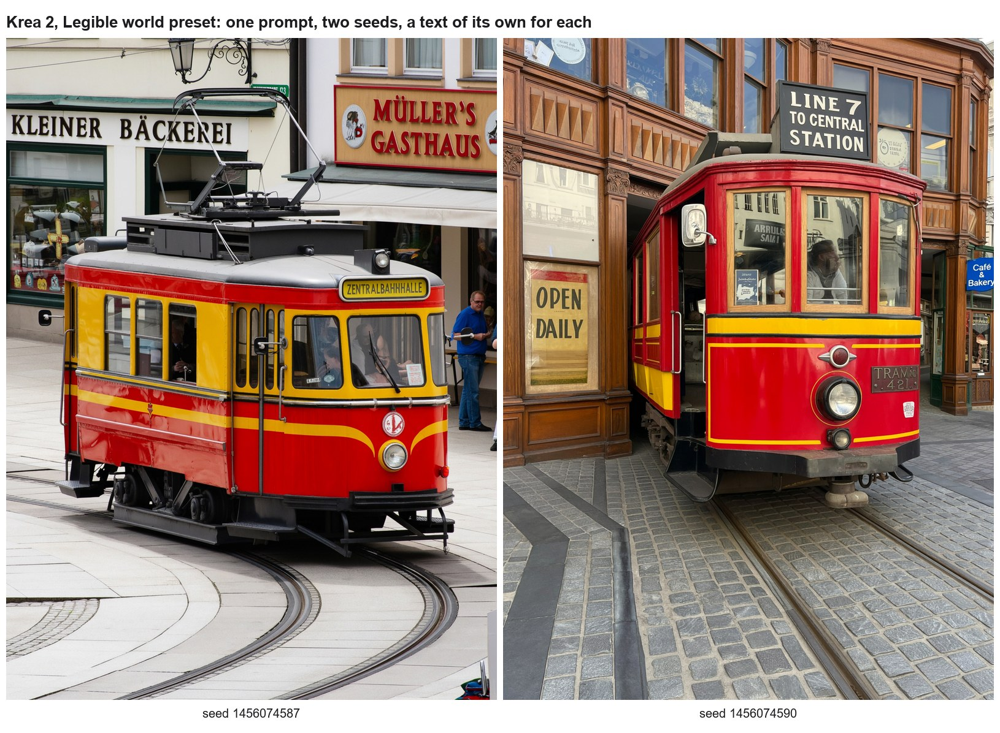

# Prompt Expansion for Forge Neo

Newer image models work best with long, concrete prompts: every shop with a name on its sign, every bus with a route, the light coming from somewhere. This extension writes that prompt for you, and it uses the model you already have loaded to do it.

Models such as Z-Image, Krea 2, FLUX.2 Klein, Qwen-Image 2.1 and MOSS-Image use a 4B to 9B chat LLM as their text encoder. Forge Neo only ever asks that LLM to read. This extension also asks it to write: at Generate, the encoder expands each prompt, and the expanded text is what gets encoded. There is no second model to download and nothing extra to keep in memory between runs.

```
a bus stop on a rainy street at night
```

becomes, with the MOSS-Image encoder and the "Legible world" preset:

```
a bus stop on a rainy street at night, featuring a translucent yellow plastic shelter with water droplets beading on its surface, positioned on the left side of the frame. A single streetlamp casts a dim, cool blue light from above, reflecting off the wet asphalt and puddles scattered across the road. In the background, blurred red taillights of distant cars streak horizontally due to motion blur. A silver sedan is parked nearby, displaying a license plate reading "742-XJN" in black characters on a white background. Above the shelter, a rectangular digital display shows the route number "42" and destination "DOWNTOWN" in bright green LED text against a dark screen. The camera is positioned at eye level, capturing a medium shot that includes the empty bench inside the shelter and the rain-slicked pavement stretching into the foggy distance under an overcast sky.
```

## Examples

The pictures below were made in Forge Neo by the extension's author with one short prompt each. The lathe pictures are consecutive seeds, not a selection. The expanded tram is the best of four tries made while the wording of the preset was being tuned. The first three sheets were made with an earlier wording of the presets, which allowed more ornament than the present one (the "warm, golden tones" in the Krea 2 texts below); the last sheet shows the present wording.

### Krea 2: the same seeds without and with expansion


Prompt as typed:

> A close-up of a working man in a helmet working at a lathe, shot on Kodachrome.

Expanded prompt of the first image in the lower row (preset *Faithful detail*; each image gets a text of its own):

> A close-up of a working man in a helmet working at a lathe, shot on Kodachrome. A close-up of a working man in a helmet, sweat glistening on his brow as he grips the handle of a lathe with calloused hands, his focused gaze fixed on the spinning metal rod; the helmet’s visor reflects faint industrial light, its surface slightly dusty from prolonged use. The lathe hums softly beneath him, its metallic body gleaming under warm, golden Kodachrome tones that saturate every curve and shadow. His work clothes are coarse denim, frayed at the elbows, stained with grease and grit. Behind him, a dimly lit workshop holds shelves of tools and coiled wires, bathed in soft ambient glow. The camera hovers just above eye level, capturing the motion blur of the rotating spindle and the rhythmic clink of metal against steel, all rendered in Kodachrome’s rich, saturated hues — deep reds, amber yellows, and cool grays — with sharp detail and a slight vignette framing the scene.

What changes. The typed prompt gives four flash-lit snapshots: a man, a machine part, and a nearly black or plain background; one helmet carries garbled lettering. With the expanded prompt every picture has a workshop around the man (tool racks, shelves, a lamp, a window), a visor or face shield on the helmet, grease on the denim and on the hands, a brass workpiece and metal chips, and a named light source. The four pictures also differ more from one another: a three-quarter view of the whole lathe, a profile, a tight close-up of the hands, a view along the spindle. The price is a shared look: every text speaks of warm, golden Kodachrome tones, so all four are warm and golden, and one gained a slide-film border.

### MOSS-Image: a new text for every image


The same typed prompt. Expanded prompt of the first image (preset *Attribute caption*):

> A close-up of a working man in a helmet working at a lathe, shot on Kodachrome. A close-up captures a working man wearing a yellow hard helmet, his face partially obscured by safety goggles as he operates a large industrial lathe. The machine itself is painted a matte grey with visible silver metallic gears and black rubber belts connecting its components. His hands grip a lever on the lathe's control panel, which features circular dials and rectangular switches arranged in a grid pattern. Sparks fly from the contact point between the spinning metal workpiece and the cutting tool, illuminating the immediate area with bright orange light against the darker machinery. The man wears a blue work shirt with rolled-up sleeves, revealing forearms dusted with fine grey particles. Behind him, a blurred wall of pale green panels provides a neutral backdrop to the mechanical activity. The entire scene is rendered in the rich, saturated tones characteristic of Kodachrome film, emphasizing deep reds in the shadows and vibrant highlights on the metal surfaces.

What you get. Each picture follows its own text closely: the yellow helmet, the sparks and the control panel with round dials in the first image, the blue wall with the stack of crates in the third, the white helmet with ventilation holes in the sixth are all in the texts. The set is varied in framing, colour and setting, and every image is clean and evenly lit. The look is that of a present-day industrial photograph rather than of 1950s Kodachrome, and in two of the nine images the close-up turned into a wider shot, because a caption that lists the things in the background asks for them to be shown.

### Lettering: the Legible world preset, earlier wording


Prompt as typed:

> A classic red-and-yellow tram from the 1950s on tracks on a town square.

Expanded prompt of the right image (preset *Legible world*):

> A classic red-and-yellow tram from the 1950s glides along tracks embedded in a sunlit town square, its polished metal body gleaming under overhead lamps. The tram’s front window reflects the pale blue sky and scattered clouds, while its side panels bear faded lettering: “TOWNLINE TRAMWAY” in bold black capitals above “ROUTE 3 TO CENTRAL STATION.” Its wheels click softly against the rails as it moves past a stone bench and a lamppost with a brass globe. A small sign beside the tram reads “OPEN DAILY 8 AM–6 PM” in green letters on white background. Behind it, a café awning displays “COFFEE & CROISSANTS” in cursive script. The tram’s destination board flickers with “CENTRAL STATION” in bright yellow, and its license plate reads “TRM-5472.”

What changes. Left to itself, the model knows that a tram has a route number and a destination board but not what they say: the board reads "ARPE", the number is "06", and the lettering along the side is a squiggle. With the expanded prompt every piece of writing has been decided beforehand, in capitals, and the model draws it: the company name on the roof board, the destination, the plate "TRM-5472", the kerb sign and the café awning. One board lost a letter ("CENTRAL TATION"); short texts in capitals are what the image models get right most often, which is why the preset asks for them.

### Legible world, present wording



Prompt as typed:

> A classic red-and-yellow tram from the 1950s on tracks on a market square, surrounded by shops and businesses.

Expanded prompt of the left image:

> A classic red-and-yellow tram from the 1950s on tracks on a market square, surrounded by shops and businesses. The tram’s body is painted in glossy red with bold yellow stripes along its sides, featuring chrome accents on the front grille and side mirrors; its wheels are black with visible steel rims, rolling along dark metal tracks embedded in a paved square. To the left, a shopfront displays a sign reading “KLEINER BÄCKEREI” in black serif lettering on a white background, while to the right, another storefront has a sign that says “MÜLLER’S GASTHAUS” in red capital letters on a wooden panel. Above the tram, a street sign reads “MAINSTRASSE 123” in white text on a green background, mounted on a wrought-iron post. The tram’s destination board above the windshield shows “ZENTRALBAHNHALLE” in black font on a yellow panel.

Expanded prompt of the right image:

> A classic red-and-yellow tram from the 1950s on tracks on a market square, surrounded by shops and businesses. The tram’s body is painted in glossy red with bold yellow stripes along its sides, featuring chrome accents and round headlights; its front displays a black sign with white lettering reading "LINE 7 TO CENTRAL STATION". The tracks are made of dark steel, embedded in a paved square with cobblestone edges. Shops lining the square have wooden facades and glass windows, one displaying a faded poster with “OPEN DAILY” in black ink on a yellow background. A small blue sign above a shop door reads “Café & Bakery” in white sans-serif font. The tram’s side mirror reflects a blurred passerby, and its rear has a weathered metal plate with “TRAM NO. 421” engraved in raised letters.

What you get. Both texts begin with the typed prompt, word for word, and go on in plain statements: what a thing is, its colour, its material, where it is. Each seed decides for itself where the square is, and the lettering follows. The left text put it in a German-speaking town: a bakery, an inn, a street sign and the tram's destination, all in German, and the model drew them as written: one letter of the destination came out slightly malformed, and the street sign is too small to read. The German is mostly right ("Kleiner Bäckerei" should be "Kleine Bäckerei", and the destination is an invented word). The right text chose English: the line and destination on the roof board, a poster, a shop sign and the tram's number plate.

## Supported text encoders

| Image model | Text encoder | Notes |
|---|---|---|
| Z-Image, FLUX.2 Klein 4B | Qwen3-4B | |
| Krea 2 | Qwen3-VL 4B | |
| Qwen-Image 2.1 | Qwen3-VL 8B | |
| MOSS-Image | Qwen3.5 9B | |
| P-Image-OSS (formerly P-H3-Image), and MiniMax-H3-Image run with its encoder | Qwen3-VL 4B | Through the [MiniMax H3 extension](https://github.com/aoleg/pruna-P-H3-Image-forge-neo). A better-writing encoder can be built, see below |
| FLUX.2 Klein 9B | Qwen3-8B | Downloads its output head (1.24 GB) at first use, see below |

All six were run on real encoder files through Forge Neo's own loader.

**FLUX.2 Klein 9B.** Qwen3-8B keeps its output table (`lm_head`) apart from its input table, and the usual fp8 and fp4 encoder files for Klein 9B were saved without it. Qwen publishes that table as a file of its own, and the extension downloads it for you: the first time you generate with Klein 9B and the panel switched on, it fetches `model-00005-of-00005.safetensors` (1.24 GB, Apache 2.0) from [Qwen/Qwen3-8B](https://huggingface.co/Qwen/Qwen3-8B) into the text encoder folder your Klein 9B encoder was loaded from, as `qwen_3_8b_lm_head.safetensors`. The file is checked against its SHA-256, and from then on it is found on disk. This is the only time the extension goes online. The encoder in the Klein 9B files is the unmodified Qwen3-8B, so this is its true head.

The console shows the download and its progress; Interrupt stops it, and the next job goes on where it stopped. If it fails (no connection, a full disk, a folder that cannot be written), the console says why and how to get the file by hand, the job goes on, and the download is tried again after a restart or when you press the panel's refresh button. To do it by hand, download [the file](https://huggingface.co/Qwen/Qwen3-8B/resolve/main/model-00005-of-00005.safetensors) and put it into a text encoder folder under any name; it is recognised by its content. A mirror set in `HF_ENDPOINT` is used.

While the true head is not there, the extension borrows a head of the same size from another text encoder file in your folders, if there is one. The Qwen-Image 2.1 encoder (Qwen3-VL 8B) has one, and Qwen3-VL 8B is built on Qwen3-8B, so it works, but clearly worse: about one text in ten does not come to an end, and thinking is not available. The panel names the file it borrows from. With no head at all your prompts are used as typed. An encoder file that contains its own `lm_head` (the full-precision 16 GB file does) is used directly, and nothing is downloaded.

**P-Image-OSS and MiniMax-H3-Image: a stock encoder.** Pruna's text encoder is a Qwen3-VL 4B that was retrained for the image model, plus a small text connector that turns its hidden states into the conditioning. The retrained model writes poor text: invented words on signs, a tram with rubber tyres. The stock Qwen3-VL 4B behind the same connector writes well, and pictures made with it are good; its conditioning stays close to Pruna's (0.97 to 0.99 cosine per token, so results are not identical to Pruna's own encoder).

The extension builds that encoder for you. With a P-Image-OSS or MiniMax-H3-Image checkpoint loaded, open **Advanced**, choose under **Build as**, and press **Build stock encoder for P-Image-OSS**. The first press shows what will be built and from what, and the button then reads **Click again to build**; the second press does it.

| Build as | Made from | Download | Result |
|---|---|---|---|
| int8 with ConvRot (the default) | Qwen's full-precision model, rotated and quantised row by row | 8.9 GB, unless a bf16 stock file is on disk | 5.1 GB, the format of Pruna's own int8 file |
| bf16 | Qwen's model as it is | 8.9 GB, unless a bf16 stock file is on disk | 9.1 GB |
| A copy of a stock file on disk | A Qwen3-VL 4B file in your text encoder folders, as it is stored (the Krea 2 encoder is fp8) | none, if you have such a file | as large as that file |

int8 with ConvRot is the best of the three to run: measured against the bf16 build, its conditioning is 1.0 % off (cosine 0.99995), where the fp8 copy is 4.0 % off (0.9992). It is quantised with the same arithmetic Forge decodes it with (comfy-kitchen's), and its tensors have the names, types and shapes of Pruna's int8 file one for one.

- The stock model comes from [Qwen/Qwen3-VL-4B-Instruct](https://huggingface.co/Qwen/Qwen3-VL-4B-Instruct) (two files, Apache 2.0), or from a stock file in your text encoder folders where one fits the choice. For int8 with ConvRot and for bf16 only a file that is stored whole in full precision fits: an fp8 file, or an nvfp4 file with some layers kept whole, is passed over and Qwen's files are downloaded.
- The connector is taken from Pruna's encoder file on disk, under either of its names (`p-image-oss_text_encoder_…` or the older `p-h3-image_text_encoder_…`). If there is none, only its 262 MB are downloaded from [PrunaAI/P-Image-OSS-Comfy](https://huggingface.co/PrunaAI/P-Image-OSS-Comfy).
- No model is loaded. Quantising takes well under a minute. Downloads are checked against their SHA-256, resume after an interruption, and are deleted after the build.
- The result, `p-image-oss_text_encoder_stock_qwen3vl_4b_<precision>.safetensors`, is built next to Pruna's encoder file (in a text encoder folder, if the connector had to be downloaded). Refresh the VAE / Text Encoder list and select it in place of Pruna's encoder.

Without the web UI: `python -m lib_prompt_expansion.hybrid <text encoder folder>` in the extension's folder, with Forge's Python; `--plan` only says what would be done, `--precision int8_convrot`, `bf16` or `copy` chooses the kind.

Licences: the Qwen3-VL-4B parts are under the Apache License 2.0. The text connector is part of P-Image-OSS by Pruna AI, based on MiniMax-H3, and under the [MiniMax H3 Community License Agreement](https://huggingface.co/PrunaAI/P-Image-OSS/blob/main/LICENSE), like the image model itself. The built file is for your own use under those terms; it is not Apache-licensed as a whole.

**MiniMax-H3-Image with its own 32B encoder** cannot be supported: that encoder is cut off after 50 of its 64 layers and has no output side at all.

Flux.1, Chroma, Wan, SD 1.5 and SDXL cannot be supported either: T5 and CLIP are encoders only and cannot write text. With such a checkpoint the extension does nothing and says so in its panel.

Quantised encoder files work: scaled fp8, fp8 mixed and int8 files were tested. GGUF files were not.

## Install

Clone into Forge Neo's `extensions` folder and restart the UI:

```
git clone https://github.com/aoleg/webui-prompt-expansion
```

Keep the folder name `webui-prompt-expansion`. Forge names an extension after its folder, and the rule that runs this extension after Dynamic Prompts and after Forge's comment remover is written for that name.

There are no extra Python packages.

## Use

Open the **Prompt Expansion** panel in txt2img or img2img, tick **Enable**, and generate as usual.

- **Preset**: a ready-made instruction for the encoder. Choosing one fills the box below. The panel opens with the preset you chose last time.
- **Expansion prompt**: the instruction itself. Edit it freely; what is in the box is what is sent. Your own prompt follows it as the request. `{words}` is replaced by the length. An edit lasts until the page is loaded again: the text is not saved, and the panel then shows the preset's own text. To keep an edited instruction, save it as a preset of your own (see Presets below).
- **Start with my prompt**: the expansion begins with your prompt, word for word, and continues it. Each preset sets this; it is off for the presets that rewrite or translate.
- **Length (words)**: how long the result should be. 0 uses the preset's own length. It is a guide, not a count.
- **Expansion seed**: -1 picks a new random seed for every job. Any other value is the seed of the first prompt; each next prompt of the job gets the next number.
- **Advanced**: sampling on or off, temperature, top p, the token limit, how many prompts are written side by side, thinking, and whether all prompts of a job are encoded at once.

Every image of a batch gets its own expansion, so one typed prompt gives a varied batch. The console shows one line per job, for example `[Prompt Expansion] 8 of 8 prompts expanded by Qwen3-VL 4B in 9.7 s, seeds from 1234`.

## Presets

| Preset | What it asks for |
|---|---|
| Faithful detail | Your prompt, continued with the look of each subject, materials, setting, framing and light. Adds no lettering. |
| Legible world | The same, and things that carry writing in real life get short, plausible text in capitals: a name, a route number with its destination, a plate. At most four pieces; in the language and script of the place. A request with a vehicle gets a random route number and plate number to use, so they differ from picture to picture. |
| Soviet era | A photograph from the Soviet Union, 1950s to 1980s, rewritten as an archive caption: "A color photograph from the 1970s in Kiev, Soviet Union, of …", with plain visual detail: clothing, setting, camera angle and light. A mild preset: it adds only what the image model gets wrong on its own. Schoolchildren get the Soviet school uniform, vehicles their models of the request's decade with plates and route numbers, signs their text in Russian. |
| Photographic | A real photograph: camera distance and angle, lens, depth of field, light source, time of day. |
| Cinematic still | A single frame from a film: shot size, staging, light sources, colour palette. |
| Illustration | A drawn or painted artwork. Uses the medium you name, or picks one that suits the subject. |
| Attribute caption | A careful caption: colour, shape, size, texture, quantity and position of every object. |
| Tags to prose | Turns a comma-separated tag list into sentences without adding anything. |
| Translate and expand | Takes a prompt in any language and writes the expansion in English. Text you put in quotes stays in its original script. |
| Minimal polish | Fixes grammar and order, adds nothing, keeps the length. |

Faithful detail, Legible world, Photographic, Cinematic still, Illustration and Attribute caption continue your prompt: the result starts with it, word for word. The presets do not ask the encoder for that. The extension puts your prompt at the start of the encoder's answer and the encoder goes on from there, which keeps your words exactly and stops it from saying them a second time.

All presets ask for plain statements of what is in the picture, the way a precise user types a prompt: what a thing is, its colour, its material, where it is. No story, no comparisons, no sounds or smells, no mood.

Presets are plain text files in `presets/`. To add your own, put a `.txt` file in `presets/user/` (create the folder). The file name is the preset's name. Two optional first lines: `# words: 150` sets its default length, and `# begin: request` ticks **Start with my prompt**. A user preset with the name of a shipped one replaces it.

**Soviet era** follows the colour mode of the request strictly. A request that says black and white, b&w, bw, monochrome, sepia or чёрно-белое gets no colour words at all (no "red pioneer tie" in a black-and-white picture; one the encoder writes anyway is taken out, with the tones kept); any other request gets the colours of the main things named, so that the image model does not fall back to black and white. Schoolgirls wear a dark brown dress with a white collar and cuffs, white hair bows and a black apron, or a white one on festive days, on the first of September and for first-graders; schoolboys wear a plain dark navy suit with a light blue shirt, or a white one on the same festive days (a grey tunic in the 1950s, a grey wool suit in the 1960s); a group of schoolchildren whose request names neither girls nor boys is described as girls and boys together; pioneers wear a red pioneer tie, Octobrists and first-graders none. Cars and buses are named by the models of the request's decade (GAZ-21 Volga, VAZ-2101 Zhiguli, LiAZ-677, ZiU-9 trolleybus and so on), every car carries a plate in the format of the decade in Cyrillic letters (two letters and four digits in the 1950s, "47-19 ЛДА" from the 1960s to the 1980s), a bus, trolleybus or tram shows a route number and its destination, and a shop has one sign. All text is in Russian unless the request names another language. The decade must be in the request ("1970s", "70s", "1975", "1970-е") for the vehicles and uniforms of that decade to be described. The preset describes no buildings.

A preset file can also steer what goes into the encoder and what comes out of it, without any code:

- **Blocks for some requests only.** Lines between `# if: black and white, b&w, bw, sepia` and `# end` go to the encoder only when the request contains one of the terms; `# else` starts the lines for all other requests, and blocks can sit inside blocks. A term matches whole words in any case; `school*` matches every word that begins with "school". Each request in a batch gets the instruction that fits it, so the encoder never sees a rule it would apply to every picture. A term written `!boy*` holds when the request has no such word: `# if: girl*, !boy*` means girls are named, or no boys are.
- **What must be said.** Lines between `# add if missing: dress, dresses, apron*` and `# end` never go to the encoder. After the expansion they are put at the end of the text when it contains none of the terms. Soviet era uses this for the school uniform: a group of schoolchildren whose text describes only the boys' suits gets "Girls' school uniform: a dark brown dress with a white collar and cuffs, a black apron, white hair bows." added (in tones for a black-and-white picture), and the other way round; a schoolgirl alone gets only the girls' line. The console line of the job says "a missing description was added".
- **Rewrites.** `# replace in request: *children => *children, *boys and *girls` changes the request the encoder gets: "a group of schoolchildren" would go to it as "a group of schoolchildren, schoolboys and schoolgirls". A `*` stands for the rest of a word and is carried into each `*` of the replacement; the words match in any case, and a match that begins with a capital keeps it. `# replace in answer: "TAXI" => "ТАКСИ"` changes the encoder's text after the clean-up; Soviet era uses such rules for Cyrillic signs and to keep the uniform colours exact. Both work inside `# if:` blocks, which look at your prompt as typed. Inside an `# add if missing:` block a `# replace in answer:` rule runs only when that block is used: Soviet era turns "each child wears a navy suit" into "each boy wears a navy suit" only when the text has no dress or apron, and then adds the girls' uniform. Your prompt as typed is what goes into the infotext.
- **Random samples.** `{random:47-19 ЛДА}` is replaced, for every request, by a new value of the same form (each digit by a random digit, each Cyrillic or Latin capital by a random capital of the same alphabet), and `{number:2-99}` by a number in that range. A small encoder copies the sample it is given, so plates and route numbers then differ from picture to picture instead of coming out as "12", "42" or "AAA 123" again and again. The values follow the Expansion seed, so a fixed seed gives the same text again; with Sampling off they are always the same. A prompt that gives a number of its own ("bus on route 40", "plate 12-34 МКА") gets no samples: every sentence that carries one is left out, so your number is kept. Years, decades, ages and model names ("1970s", "70-е", "7-year-old", "GAZ-21") do not count as numbers of your own. Put a sample in a sentence of its own, so that nothing else is lost with it.

Writing your own instruction for a 4B to 9B model, as measured on these encoders:

- **Four short parts** work best: who writes ("You turn a short image request into one text-to-image prompt, written the way a precise, experienced user types it."), what to write and how long, what to use and what never to do, and how to answer ("Answer with the prompt only").
- **Say what the text never does** in one sentence ("it never tells a story, never compares one thing to another, and never mentions sounds, smells, feelings, mood or atmosphere"). In this frame that worked; the same list as a loose "leave out…" did not.
- **Give no examples of content.** A small model copies them: "for example anime, watercolour" turned photo prompts into watercolours, and "a bus gets a route number and destination" put a passing bus into more than half of the street scenes that had none. Name the kind of text or detail you want, not a thing that carries it.
- **One number per sentence.** "At most six pieces of text, each of four words or fewer" gets the two limits mixed up.
- **Do not ask it to begin with your prompt**; tick **Start with my prompt** instead.
- **Put a rule for some pictures in a block.** A rule about school uniforms, said to every request, put school uniforms on adults in a kitchen; inside `# if: school*, pioneer*` it never did.

## How it behaves

- **Batches.** All prompts of a job are written together, in passes of up to "Prompts per pass" (default 10). A pass takes about as long as a single prompt, so a batch of 8 costs the time of one. If your batch is larger than the pass size, raise the pass size rather than wait for a second pass.
- **Batch count.** Forge encodes the prompts of one batch at a time, so with a text of its own for every image it would need the text encoder again for each image, and on a card that cannot hold the image model, the encoder and the VAE together that means reloading models every time. With *Encode all prompts at once* (on by default) all prompts of the job are encoded right after the first one, through Forge's own encoding and into Forge's own cache; the encoder is then loaded once per job. It stands down, and says so in the console, when the prompts carry weights, when the job has an input or reference image, and with hires fix; then Forge encodes one image at a time as before.
- **Dynamic Prompts and wildcards** are resolved first; the encoder only sees the final text of each image.
- **LoRA and other `<name:value>` tags** are taken out before the encoder sees the prompt and put back at the end.
- **Weights** such as `(red car:1.4)`, `((fog))`, `[crowd]` and `(dress:-1)` are taken out before the encoder sees the prompt and marked again in the expanded text: a phrase the text kept is wrapped again where it first occurs, a phrase whose words moved apart gets each word wrapped, and a phrase the text lost is added at the end. A phrase with a weight of zero or less (NegPiP's "less of this") is never shown to the encoder, which would only write more about it, and goes to the end as typed. When your prompt uses a weight with a number, brackets the encoder writes itself are escaped (`\(aside\)`) so that they are not read as weights. Forge Neo itself treats brackets as plain characters for the models listed above; weights act through an extension such as [NegPiP](https://github.com/aoleg/neo-krea2-negpip). With Forge's Emphasis setting on "None" the extension leaves them alone as well.
- **Sounds and smells** are removed for certain when the expansion prompt says the text never mentions them (all presets that describe a picture do): the sentence goes, or only the clause if the rest of the sentence shows something. Quoted lettering and your own words are never removed.
- **The negative prompt** is never touched.
- **Hires fix** uses the expanded prompt, unless you typed a separate hires prompt.
- **Infotext.** The prompt saved with the image is the expanded one, so pasting it back reproduces the image with the extension off. Three keys are added: `Prompt expansion` (the preset), `Expansion seed` and `Expansion source` (what you typed).
- **Nothing can break a generation.** If the encoder refuses, returns nothing, or the run is interrupted, the image is generated from the prompt as typed.

The answer is cleaned before use: introductions and Markdown are removed, a text cut off by the token limit is trimmed to its last full sentence, and a sentence that drifts into another writing system is dropped. A small model sometimes locks onto one word and repeats it; that is detected, and the text before it is kept.

Three more guards keep a weak answer from costing you the picture:

- **Your prompt comes first.** With **Start with my prompt** the encoder's answer is begun with your prompt, so it cannot be lost. Should it be missing all the same (with thinking on, the answer starts with the reasoning), it is put in front when the answer has lost any of its content words or its quoted lettering. An answer that ends right after your prompt is not accepted: the encoder must add something.
- **Length.** An answer longer than 1.5 times the length asked for is cut back to it, at a sentence end, or at a clause when the text is one long sentence.
- **Self-talk.** If the encoder breaks off and starts commenting on its own writing ("Wait, let me try again"), the text is cut there.

A few things in a written paragraph would be misread by the web UI's own prompt syntax, so they are changed: an upper-case `AND` becomes `&` inside quoted lettering and `and` elsewhere; square brackets become round ones.

## Speed and memory

Measured on an RTX 5090, encoder only, ten prompts in one pass, about 150 words each:

| Encoder | File | Time for 10 prompts | With both speed-ups off | Extra VRAM while writing |
|---|---|---|---|---|
| Qwen3-4B | fp16 | 4.2 s | 5.8 s | about 2.5 GB |
| Qwen3-VL 4B | scaled fp8 | 3.1 s | 8.6 s | about 3 GB |
| Qwen3-VL 4B (P-Image-OSS, stock) | int8 ConvRot | 2.8 s | 8.3 s | about 3 GB |
| Qwen3-VL 8B | int8 ConvRot | 2.9 s | 8.9 s | about 2.5 GB |
| Qwen3-8B | fp8 mixed, with its own head | 4.2 s | 7.7 s | about 3.6 GB |
| Qwen3.5 9B | int8 ConvRot | 3.4 s | 10.0 s | about 3.8 GB |

The extra memory (the output table and the cache of the pass) is released when the job's prompts are written, before the image model starts. A single prompt takes nearly as long as ten.

A text is written one token at a time, and every token is a trip through the whole encoder: one to two thousand small GPU operations. Started one by one from Python they keep the GPU waiting; it was busy a third of the time, at about 125 W. Two things remove that:

- **A recorded step.** When the encoder has read your prompt, one such trip is recorded as a CUDA graph and replayed for every further token. The GPU is then busy all the time. The numbers are the same as without it; on Qwen3.5 the last bit of rounding can differ, which changes a word now and then, as another seed would.
- **The int8 kernel.** Forge runs an int8 text encoder by converting each weight to bf16 on every call, which is right for the conditioning and slow for writing. While a text is written, int8 ConvRot encoders go through the int8 kernel that Forge uses in its int8 image models, which reads the weights as they are stored. The activations are quantised as well, so the wording of an expansion comes out slightly different: measured with the same text fed to both, the next word was the same in 95 to 98 places of 100, and elsewhere it was the other path's second choice. The conditioning of your image is not affected, because Forge encodes the finished prompts its own way.

Both stand down by themselves, with one line in the console, where they cannot be used: the recorded step needs a CUDA GPU with the whole text encoder on it. With Forge's `--cuda-stream` the side streams are switched off while a text is written (nothing is being moved then) and on again after. The job's console line gives the speed in tokens a second, and says "written token by token" with the reason when the recorded step could not be used. Both can be switched off under **Settings > Prompt Expansion**. An *Expansion seed* gives the same text again only with the same two settings.

## What to expect from each encoder

With the shipped presets all six write plain, usable text. In the last calibration (nine presets, twenty prompts each) the number of texts with a sound or smell was 0 or 1 of 180 on every encoder, and texts with a mood word were 0 to 9.

- **Qwen3.5 9B (MOSS-Image)** follows the instruction most closely and writes the best text. It is the slowest. Its reasoning mode is switched off: it reasons at great length and did not finish within 1,500 tokens in testing. With *Legible world* it finds something to write on in nearly every scene, also in a still life.
- **Qwen3-VL 8B (Qwen-Image 2.1)** is close behind: on length, always ends cleanly.
- **Qwen3-VL 4B (Krea 2)** writes well and stays on the rules. It likes to continue your prompt as one long chain of clauses rather than in separate sentences.
- **Qwen3-8B (FLUX.2 Klein 9B)**, with its own output head, is as dependable as Qwen3-VL 8B. Thinking works on it. Through a borrowed head (see above) about one text in ten does not come to an end by itself and is cut back to the length.
- **Qwen3-4B (Z-Image, Klein 4B)** keeps your subjects and lettering and now stays plain, but it is the least obedient: with *Legible world* it writes only about a third of its lettering in capitals and adds text to scenes that have nothing to write on, and now and then it runs into a loop (the text before the loop is kept).
- **Pruna's P-Image-OSS encoder** (formerly P-H3-Image) is the weakest writer. It is a Qwen3-VL 4B retrained for the image model: in a few texts of a hundred it breaks off and starts talking to itself (the text is cut there, and when too little is left the prompt is used as typed). With *Legible world* its lettering is mostly invented words ("SARVAN", "BANJAL"), a route number is rare and a destination rarer, and it gets a fact wrong now and then: in the author's test two of ten trams were given rubber tyres by the text, and MiniMax-H3-Image drew them so. The stock encoder built as described above writes like Krea 2's: real names in the language of the place, and every text usable.

No refusals were seen with ordinary prompts. A stock model may still decline some; then the prompt is used as typed.

## Limits

- The expansion is not reproducible across batch sizes. The same job with the same expansion seed gives the same text; the same prompt in a batch of 4 and a batch of 8 may not. The infotext holds the text that was used.
- Prompt editing (`[a:b:0.5]`, `[a|b]`) and `BREAK` in your own prompt are given to the encoder as plain text and will usually not survive the rewrite. A negative phrase keeps the encoder from being told about a thing; it cannot stop the encoder from writing about it unasked.
- Reference images are not shown to the encoder. In img2img and edit workflows the expansion is written from the text alone.
- Qwen-Image (Qwen2.5-VL), ERNIE-Image (Ministral 3), Lumina 2 and Anima are not supported.

## Credits

The idea of using the image model's own text encoder for prompt expansion comes from [ComfyUI-SingleEncoderEnhancer](https://github.com/Magirad/ComfyUI-SingleEncoderEnhancer); the sentence trimming is adapted from it. The sampling filters follow ComfyUI's text generation. Both are GPL-3.0, and so is this extension. See [LICENSE](LICENSE).
